<!-- ═══════════════════════ HEADER ═══════════════════════ -->

*Powered by Code, Cinema, and Sports. (Not necessarily in that order)* 

---

### 🔭 What I'm Up To

- 🛡️ **Building** **PR Sentinel**, an AI agent that reviews GitHub pull requests for security issues
- 🌍 **Growing** [**Odos**](https://odos-rbji.onrender.com/) from "deployed" into a real product people can use
- 🌱 **Learning** Deep Learning (CNNs, RNNs, GANs) and LLMs (RAG, LoRA/PEFT, quantization, evals)
- ✍️ **Writing** about cricket at [**The Fifth Day**](https://thefifthday.substack.com)
- 🎯 **Looking for** an AI development internship

 

---

### 🚀 Featured Projects

<table>
  <tr>
    <td width="50%" valign="top">
      <h4>🛡️ PR Sentinel</h4>
       
      An AI agent that reviews GitHub pull requests for security vulnerabilities and refactoring opportunities. It pulls the PR diff and asks an LLM for structured findings: file, line, issue and suggested fix. Coming next: MCP tools, hooks and a GitHub Actions step that runs it on pull requests.  
      <b>Python · GitHub API · LLMs via OpenRouter · Claude Code</b>
    </td>
    <td width="50%" valign="top">
      <h4>🌍 Odos</h4>
       
      A travel tracker built around an interactive SVG world map: log the countries you've been to and watch the map fill in.  
      <b>Node.js · Express · PostgreSQL · Passport (Google OAuth) · EJS</b> Deployed on Render with Neon Postgres
    </td>
  </tr>
  <tr>
    <td width="50%" valign="top">
      <h4>🏏 IPL Fantasy Decision Support</h4>
       
      Predicts IPL fantasy points and picks a squad. It turns nested match JSON into clean tables, trains a Random Forest on time-based train/test splits so no future data leaks into training, and builds the squad with a greedy optimiser.  
      <b>Python · scikit-learn · NumPy · Streamlit</b>
    </td>
    <td width="50%" valign="top">
      <h4>💼 Patina</h4>
       
      A team-built job platform with separate candidate and recruiter experiences and an NLP engine under the hood.  
      <b>React (Vite) · Node.js · Express · Passport (Local / Google / GitHub OAuth)</b> Role-based access control
    </td>
  </tr>
  <tr>
    <td colspan="2" valign="top">
      <h4>✍️ The Fifth Day</h4>
       
      A sports media brand I founded. It's mostly cricket, with the odd detour into football and tennis, and starts as a Substack newsletter.
    </td>
  </tr>
</table>

---

### 📊 GitHub Stats

<picture>
  <source media="(prefers-color-scheme: dark)" srcset="./profile/snake-dark.svg" />
  <source media="(prefers-color-scheme: light)" srcset="./profile/snake-light.svg" />
  
</picture>

---

### 🛠️ Tech Stack

**Languages** 

**Full-Stack** 
 

**Data & ML** 
 

**AI & Agents** 

**Databases** 

**Tools & Deployment** 
 

---

### 🎯 2026 Goals

- [x] **Ship more code:** go from tutorials to deployed projects ([Odos](https://odos-rbji.onrender.com/) and [IPL Fantasy](https://ipl-fantasy.streamlit.app/) are live)
- [ ] **Agentic AI:** take PR Sentinel to demo-ready
- [x] **Sports analytics:** build dashboards that decode the game
- [ ] **Land an AI development internship**

---

### ⚡ The Person Behind the Code

- 🏏 Die-hard **Mumbai Indians** fan (Paltan 💙) and ⚽ **Liverpool FC** supporter (YNWA 🔴).
- 🎬 Massive **Cinema Geek**, especially for Marvel and Star Wars. You'll find me logging everything on Letterboxd.
- 📚 **Currently Reading:** *The Trading Game* by Gary Stevenson.
- 🎧 **Currently Listening:** *Animal Farm* by George Orwell.

---

### 📬 Let's Connect

